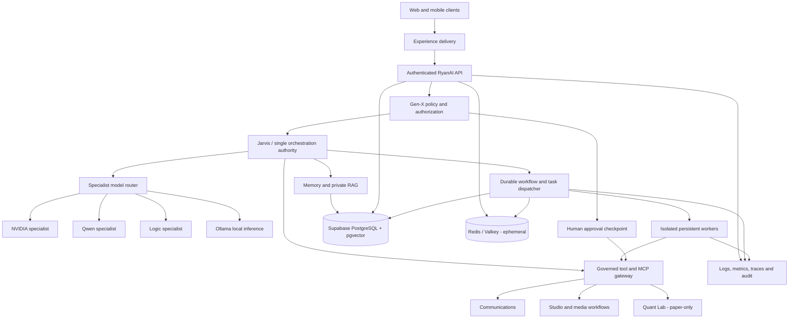

# RyanAI canonical topology and deployment contract

**Status:** Approved target architecture; documentation-only contract.
**Baseline inspected:** official `main` at `350c635b7904e0e5379f09987ace9995f0b0212c` (7 November 2026).
**Authority:** This document defines service ownership and migration gates. It does not assert that target hosting is already implemented or healthy.

## 1. Architectural objective

> One RyanAI platform. One authoritative memory. One orchestration authority. Multiple specialised intelligence engines. Independently deployable services. End-to-end operational reliability.

RyanAI is a modular platform with explicit control, execution, and data planes. Keep the core API cohesive; split out workloads only when their runtime, scaling, security, or availability requirements justify independent deployment. Do not introduce Kubernetes, a service mesh, another database, another agent framework, or another infrastructure provider as part of this completion effort.

## 2. Logical topology

The diagram is logical, not a claim that every box is a separate deployed service. The API, Gen-X enforcement adapter, orchestration entry point, and memory access layer may remain modules in the core API process where that preserves clear boundaries. Persistent workers and heavyweight specialist runtimes are isolated processes.

## 3. Non-negotiable ownership

| Concern | Authoritative owner | Contract |
| --- | --- | --- |
| User experience | RyanAI web/mobile clients | Clients call the canonical API; no direct privileged database access |
| Authentication and identity | Supabase Auth | Verified principal and tenant/owner scope are established server-side |
| Authorization and policy | Gen-X enforcement boundary | Deny by default; independent of model output and orchestration |
| Orchestration | Jarvis through the RyanAI orchestration service | One task coordinator; no model self-authorization or self-approval |
| Durable application data and memory | Supabase PostgreSQL | One canonical relational source of truth |
| Semantic retrieval | pgvector in the same authoritative PostgreSQL estate | Owner-scoped, provenance-aware and versioned embedding spaces |
| Ephemeral coordination | Redis / Valkey | Cache, short-lived coordination and queue acceleration only; never authoritative memory |
| Model selection | RyanAI specialist router | NVIDIA, Qwen, Logic and Ollama behind typed, versioned adapters |
| Tool execution | Governed tool registry and MCP gateway | Explicit capability allowlist, scoped identity, validated arguments and audit |
| Long-running work | Durable task records plus independently supervised workers | Leases, idempotency, bounded retries, dead-letter handling and restart recovery |
| Human authority | Authenticated owner/operator approval | Approval binds to the exact action payload; changed payload requires fresh approval |
| Operational evidence | Shared observability and audit contracts | Correlated task, actor, policy, model, worker and outcome identifiers |

Models are untrusted service dependencies, not principals. They cannot grant permissions, select a broader identity, bypass Gen-X, read secrets, approve actions, merge code, or deploy.

## 4. Deployment ownership: target and current transition state

### 4.1 Approved target responsibility map

| Provider | Target responsibility | Explicit exclusions |
| --- | --- | --- |
| Render | Static RyanAI frontend delivery | No second authoritative API or worker implementation |
| Vercel | Stateless backend/API edge execution after API compatibility is proven | No durable worker ownership, database ownership, or duplicate full API |
| Railway | Persistent Docker workloads: supervised workers, MCP runtime where persistent execution is required, and isolated specialist runtimes | No competing production database or duplicate API |
| Supabase | Auth and authoritative managed PostgreSQL/pgvector | No parallel authoritative memory store |
| Existing Redis / Valkey resource | Ephemeral cache/coordination, subject to verified connectivity and availability | No durable memory or sole record of task state |

A provider assignment is not evidence of deployment, connectivity, capacity, or health. Provider changes require a separate implementation and acceptance review.

### 4.2 Repository-observed state at the inspected baseline

The following is what the checked-in contracts declare, not a live provider health assessment:

- `render.yaml` defines `ryanai-web` as a Render static site and `ryanai-api` as a Render Docker web service using `Dockerfile.api`; the frontend points to `https://ryanai-api.onrender.com`.
- `render.yaml` also defines `ryanai-redis` as a Render Key Value resource.
- `railway.json` declares a Docker deployment using `Dockerfile.api` and `/health`. It does not by itself establish which Railway service is deployed or whether it is a worker.
- `stacks/ryanai.stack.json` describes a Compose-oriented API, web, MCP, PostgreSQL and Redis stack. Its defaults currently name Render for both frontend and API and Railway for persistent workloads.
- `scripts/validate-deployment-contracts.mjs` currently asserts Render ownership of frontend and API and rejects legacy Vercel integration.
- `scripts/validate-stack-manifest.mjs` validates the separate stack manifest and its existing provider defaults.

Consequently, the target map in section 4.1 is **not yet the implemented deployment contract**. The current Render API remains the transition API until a separately reviewed Vercel-compatible API entrypoint, routing, runtime limits, connection pooling, observability, and rollback are demonstrated. Do not repoint the frontend or disable the Render API as part of this documentation PR.

### 4.3 Migration sequence and safety

1. Keep the currently declared Render frontend/API route unchanged while establishing a passing exact-head baseline.
2. Inventory API routes, streaming/websocket needs, background tasks, filesystem assumptions, timeouts, and Node runtime dependencies.
3. Design and test a stateless Vercel adapter only for request/response API workloads that meet Vercel runtime constraints. Preserve one canonical API contract and avoid dual-write/dual-authority operation.
4. Move persistent queues, scheduled work, MCP processes that need a resident runtime, and specialist inference workers to Railway only after worker lifecycle and health evidence pass.
5. Change the frontend API origin only after staging end-to-end tests, auth/cookie/CORS checks, observability correlation, and a tested rollback.
6. Retire a previous route only after traffic and task-drain evidence, explicit owner approval, and a rollback window.

No provider switch, production deployment, resource provisioning, paid upgrade, secret edit, or production database change is authorised by this document.

## 5. Data and memory contract

- PostgreSQL is the single authoritative store for user, conversation, task, approval, audit, and memory records.
- pgvector is the semantic retrieval capability within that same database authority; vectors must be scoped to the same owner/tenant permissions as source records.
- Every derived memory item must retain provenance: source record/reference, owner scope, timestamps, transformation/model version, and deletion lineage.
- Redis/Valkey may accelerate coordination but durable task state, checkpoints, approvals, and memory must survive its loss.
- Supabase Auth remains the identity authority. A provider move must not create a second identity system.
- Object/media storage must use owner-scoped access and explicit retention/deletion propagation; uploads remain disabled until scanning, quarantine, and access checks are proven.
- Staging migrations and restore tests precede any production migration proposal. Production migration requires separate explicit approval.

## 6. Execution and orchestration contract

- One orchestrator coordinates tasks and delegates to typed specialist adapters or governed tools.
- Gen-X makes deterministic authorization decisions at the execution boundary, using verified identity and current policy.
- Jarvis is a restricted orchestration/engineering capability, not an independent security authority.
- Every task has a durable identifier, owner/tenant, validated input schema, idempotency key, state, attempt count, timestamps, and outcome/provenance.
- Workers claim jobs with expiring leases; retries are bounded and classified; poison jobs reach a dead-letter state; restarts recover from durable task state.
- A tool call rechecks authorization immediately before execution. Consequential actions require human approval bound to a canonical action digest.
- Comms outbound dispatch remains human-reviewed and disabled until provider callback, destination verification, and explicit test authorization are demonstrated.
- Quant Lab remains isolated virtual paper trading only; no brokerage credentials, order routing, or real-money execution.
- A model outage or invalid output must produce a bounded failure/abstention or an explicitly approved fallback, never an unannounced cloud fallback from local-only mode.

## 7. Service interface contract

Every independently deployed service must publish and maintain:

1. Stable service name, owner, repository path, runtime, deployment target, and data dependencies.
2. Versioned request/event schemas and backwards-compatibility policy.
3. Authentication mechanism and caller identity propagation; no trust in caller-supplied owner IDs.
4. Readiness and liveness endpoints with distinct semantics; readiness must test required dependencies without exposing secrets.
5. Timeout, concurrency, retry, cancellation, idempotency, and graceful-shutdown behaviour.
6. Structured logs, metrics and traces carrying request/task/correlation IDs.
7. Data classification, retention, deletion, and secret ownership.
8. Failure modes, fallback policy, recovery steps, and rollback owner.

Do not split a module into a new service solely to make the diagram look distributed. Split only when isolation, independent scaling, release cadence, or failure containment has a demonstrated benefit.

## 8. End-to-end reliability acceptance

Topology is not complete until evidence demonstrates the following on the exact reviewed commit and a controlled non-production environment:

- Browser/client → canonical API → verified Supabase identity → Gen-X authorization → application operation.
- API → PostgreSQL read/write and owner-scoped pgvector retrieval with provenance.
- API → durable task creation → worker claim → execution → persisted result → restart/recovery without duplicate side effects.
- Orchestrator → each configured model adapter, with real readiness/inference probe, timeout, abstention, and tested fallback.
- Orchestrator → MCP tool → authorization recheck → audit record; denied calls have no side effects.
- Human approval → exact action digest → single permitted dispatch; changed payload invalidates approval.
- Module journeys across Memory Vault, Studio, Audiobook, Comms and Quant Lab use the same identity, task, memory and audit contracts.
- Telemetry correlates request, task, worker, model, policy decision and outcome.
- CI and security checks complete successfully for the exact head. Queued, skipped, cancelled, missing, stale, or provider-blocked checks are not passes.

## 9. Change-control boundaries

This contract does not authorise production deployment, production database migrations, secret creation/modification/rotation, credential disclosure, paid upgrades, live external communications, auto-merge, or bypass of human review. Each requires the established separate authorization. PRs remain separate branches with exact-head CI/security evidence and human review.

## 10. Implementation backlog

See [RyanAI topology integration backlog](./TOPOLOGY_INTEGRATION_BACKLOG.md) for the scoped PR B and PR C work packages, dependencies, acceptance evidence, and explicit exclusions.
